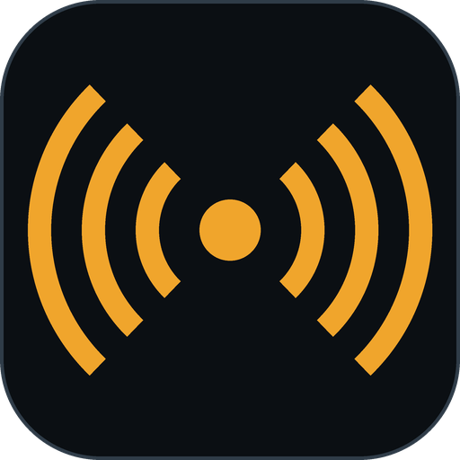
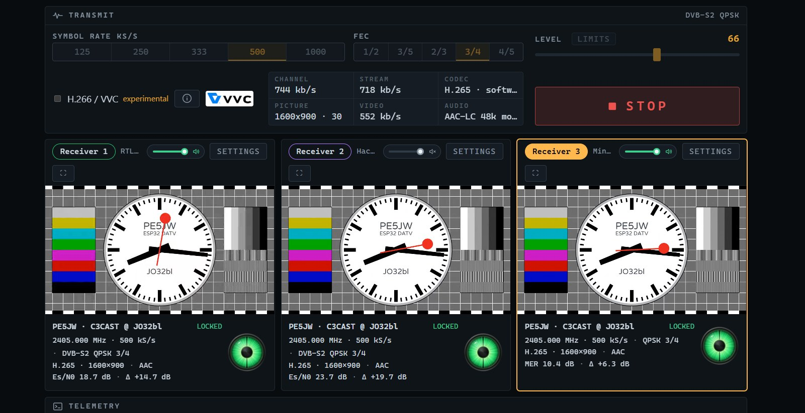
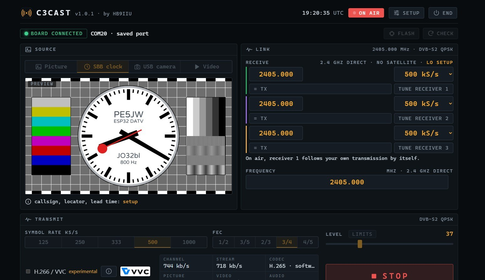
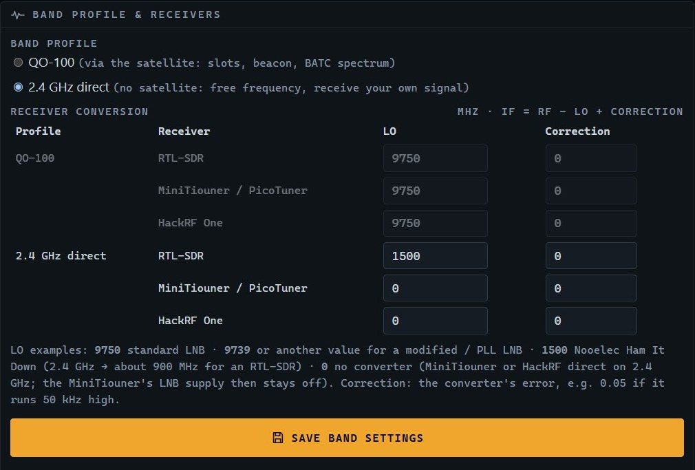
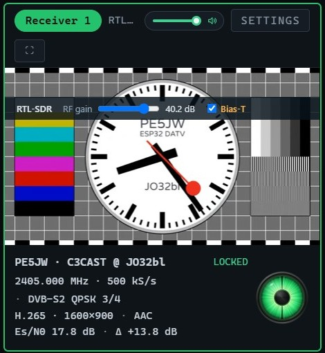
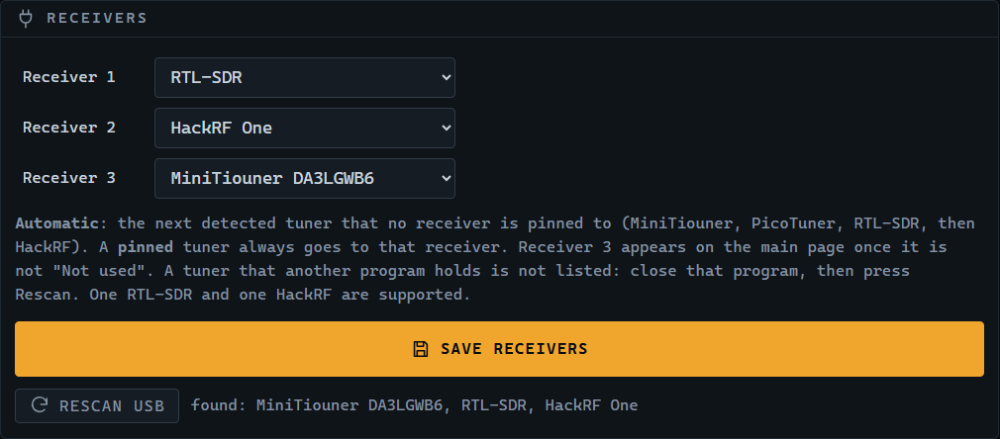

#  C3CAST-plus

### C3CAST with direct 13 cm reception, adjustable LNB / converter LOs, a HackRF receiver and up to three receivers

**C3CAST-plus** is PE5JW's extended version of **[C3CAST](https://github.com/HB9IIU/C3CAST) by HB9IIU**, the
"5 EUR DATV modulator" that turns a Seeed Studio XIAO ESP32-C3 into a DVB-S2 transmitter on 13 cm with
**[ESP32-DATV](https://github.com/SP8ESA/ESP32-DATV) firmware by Kacper SP8ESA**. Everything C3CAST does still works the same
way. C3CAST-plus adds what was needed to **receive your own C3CAST signal directly on 2.4 GHz, without the QO-100 satellite**,
with whatever receivers are on the bench.

> C3CAST-plus is not an official HB9IIU release. Please report problems with the features below here, not to HB9IIU or SP8ESA.
> Version **1.0.1-plus.1** is based on C3CAST 1.0.1.

<h2 align="center"><a href="https://github.com/pe5jw/c3cast-plus/releases/latest">&#11015; Download C3CAST-plus for Windows</a></h2>
<p align="center">Windows 10/11 &nbsp;·&nbsp; no installation &nbsp;·&nbsp; unzip and double-click <b>C3CAST-plus.exe</b> &nbsp;·&nbsp; quit with <b>END</b></p>

<p align="center">
  
  <br><em>One C3CAST transmission at 2405.000 MHz, 500 kS/s, QPSK 3/4, received at the same time by
  an RTL-SDR with a Nooelec Ham It Down (RX1), a HackRF One (RX2) and a MiniTiouner Express (RX3).</em>
</p>

## Why C3CAST-plus?

C3CAST is built for QO-100. Its receivers expect the satellite downlink: they take their frequencies from the BATC wideband
spectrum, start on the beacon, and assume a standard 9750 MHz LNB. That is right on the air, but it gets in the way when you want to:

- **check your own signal on the bench**, straight from the board's antenna or through an attenuator, before going near the satellite;
- **use a different LNB** (a modified or PLL LNB with another local oscillator) or a **downconverter** in front of an RTL-SDR;
- **use the receivers you have**: an RTL-SDR with a Nooelec Ham It Down, a MiniTiouner Express that tunes 2.4 GHz directly, a HackRF;
- **decide which receiver gets which panel**, and watch with **three** receivers at once.

## What changed, and why

### 1. Two band profiles: QO-100 and 2.4 GHz direct

The **Setup** page has a new *Band profile & receivers* section.

- **QO-100** works exactly as in C3CAST: uplink slots, beacon, BATC spectrum, the downlink shown next to the uplink.
- **2.4 GHz direct** removes everything that only makes sense via the satellite: no BATC spectrum, no beacon, no slot grid,
  no uplink/downlink offset. The transmit frequency stays free within 2300 to 2450 MHz, and the receivers listen on 13 cm themselves.

<p align="center"></p>

In the 2.4 GHz profile there is no spectrum to click, so **each receiver has its own receive row**: frequency, symbol rate,
**= TX** (copy the transmit settings) and **Tune Receiver N**, marked with the receiver's colour. As before, receiver 1 follows
your own transmission by itself when you go on air.

### 2. An adjustable LO and correction, per profile and per kind of receiver

C3CAST had the 9750 MHz LNB fixed in the receivers. C3CAST-plus lets you set the oscillator of whatever sits in front of each
kind of receiver, separately for each profile:

<p align="center"></p>

The receiver tunes **IF = RF − LO + correction** (MHz). Examples:

| What is in front of the receiver | LO | Typical use |
|---|---|---|
| Standard universal LNB | 9750 | QO-100 (the default, as in C3CAST) |
| Modified or PLL LNB | e.g. 9739, or its own value | QO-100 with another LNB |
| Nooelec Ham It Down (1.5 GHz LO) | 1500 | 2.4 GHz with an RTL-SDR (2405 MHz becomes about 905 MHz) |
| Nothing | 0 | 2.4 GHz with a MiniTiouner or a HackRF |

The correction takes the converter's own error, for example 0.05 if it runs 50 kHz high. A value that would put the band outside
what that receiver can tune is refused when you save, with a message saying why, so a wrong LO shows up on the Setup page and not
as a silent failure later. Changing these settings restarts the receivers (not allowed while transmitting).

### 3. MiniTiouner direct on 2.4 GHz

With LO 0 the MiniTiouner (and PicoTuner) use the **direct mode** that the bundled tuner service already had (QOCAST's "local
mode"): the frequency goes to the tuner as it is. In that mode the **LNB supply is always off**, even if it is switched on in the
receiver's settings, so no 13 or 18 V ever reaches an antenna or a preamplifier.

### 4. RTL-SDR bias-T switch

A Ham It Down (or a small preamp) can be powered through the coax. The RTL-SDR's bias-T is now a switch in the receiver's
**Settings** bar, next to RF gain:

<p align="center"></p>

- It is remembered **per band profile**, and is off by default, so switching it on for a 2.4 GHz converter never puts voltage
  on a QO-100 LNB chain.
- `rtl_iq` cannot switch it, so C3CAST switches it through the bundled `librtlsdr` just before `rtl_iq` opens the stick, and
  switches it off again when the receiver closes.
- If it cannot be switched on, tuning stops with a message, so a converter that needs it is never left unpowered without you knowing.

### 5. HackRF One as a receiver

The HackRF covers 1 MHz to 6 GHz, so it receives 2.4 GHz directly (LO 0) and works behind a QO-100 LNB as well.

- **A new reader, `hackrf_iq.exe`.** `hackrf_transfer -r -` cannot be used in a pipe on Windows: it leaves standard output
  in text mode, so every 0x0A byte of the I/Q stream gains a 0x0D and the stream is corrupted. `hackrf_iq` is a small C program
  modelled on DATVision's `rtl_iq`: binary standard output, signed 8-bit I/Q into `datvrx --format cs8`, and a clean stop
  (streaming stopped, antenna power off, HackRF closed) when C3CAST closes the pipe.
- **Away from the DC spike.** A HackRF is a zero-IF receiver with a spike at its centre frequency. It is tuned 0.75 times the
  symbol rate above the carrier, so the whole DVB-S2 signal lies beside the spike, and `datvrx --carrier` decodes it there.
  The sample rate is 5 times the symbol rate, at least 2 Msps.
- **Settings:** LNA gain (0 to 40 dB), VGA gain (0 to 62 dB), the +14 dB RF amp and antenna power (per band profile, off by
  default) in the receiver's Settings bar. Detected as USB 1D50:6089.
- **Build:** libhackrf 2026.01.3 is linked into the exe, against the `libusb-1.0.dll` and `libwinpthread-1.dll` already in the
  package. `webapp/receiver/hackrf-iq/build.sh` rebuilds it on Linux with Zig's C compiler; source and licences are in the repository.

### 6. Choose which receiver gets which tuner, Rescan, and an optional RX3

C3CAST gave the first two detected tuners to RX1 and RX2, in a fixed order, and only looked once at startup.

<p align="center"></p>

- Each receiver is **Automatic**, **Not used**, or **pinned** to one tuner (a MiniTiouner by its serial number, PicoTuner
  channel 1 or 2, the RTL-SDR, the HackRF). A pinned tuner is never taken by an automatic receiver.
- **Rescan USB** releases the receivers and lists the tuners again, without restarting C3CAST.
- **Receiver 3** is off by default. Set it to anything but "Not used" and a third, orange panel appears.
- PicoTuner channel 2 shares the tuner service of whichever receiver has channel 1, no longer only RX1.

### 7. Smaller things

- `tools/build_portable.py --dev` makes a local test build that only needs `tools/ffmpeg/bin/ffmpeg.exe`: release-only files
  (ffmpeg licences and source, sample videos, release notes) are skipped when missing, and no zip is made. Never hand a `--dev`
  build to anyone. The release build is unchanged.
- When the previous dev folder is still in use, the build says so in one line instead of a traceback.

## Getting started

Download **C3CAST-plus-Portable-x64-1.0.1-plus.1.zip** from the [Releases page](https://github.com/pe5jw/c3cast-plus/releases/latest),
unzip it anywhere and double-click **C3CAST-plus.exe**. To keep the settings of an earlier C3CAST, copy its `config.json` next to
the exe.

### Building it yourself

On Windows 10/11 with Python 3.11:

```powershell
git clone https://github.com/pe5jw/c3cast-plus.git
cd c3cast-plus
py -3.11 -m venv .venv-host
.venv-host\Scripts\python.exe -m pip install -r webapp\requirements.txt pyinstaller
# copy the folder tools\ffmpeg from an official C3CAST portable package to tools\ffmpeg here
.venv-host\Scripts\python.exe tools\build_portable.py --dev
```

Start `dist\C3CAST-plus-Portable-x64-1.0.1-plus.1-dev\C3CAST-plus.exe`. Or, without building, run it from source:
`.venv-host\Scripts\python.exe webapp\c3cast.py`.

A release build (without `--dev`) also needs the ffmpeg licences, source and `buildconf.txt`, and the two sample films in
`webapp/videos`; it runs the licence / source audit and makes no zip unless that passes.

### First start

On the **Setup** page:

1. Callsign and locator, as in C3CAST.
2. **Band profile**: QO-100, or 2.4 GHz direct.
3. **Receiver conversion**: check the LO of each kind of receiver you use (the defaults are in the table above).
4. **Receivers**: leave them on Automatic, or pin each tuner to the receiver you want. Press Rescan after plugging something in.

Everything else (the board, flashing, sources, output level, video files, H.266) works as described in
**[the original C3CAST README](docs/C3CAST-README.md)**.

## Please read

- **Licensed radio amateurs only.** You are responsible for frequency, power and bandwidth. For on-air operation use suitable RF
  filtering and check the spectrum, as SP8ESA and HB9IIU recommend.
- **Mind your receivers' input level.** Receiving your own transmitter at short range can overload a receiver, or damage it on a
  cable. Use an attenuator on any cable connection, start at a low level, and leave the HackRF's RF amp off near your transmitter.
  Check each receiver's maximum input level in its own documentation.
- **Bias-T and antenna power** put voltage on the antenna input. Never use them into a cable, splitter or LNB that already carries
  voltage. Power a Ham It Down either by USB or by the bias-T, never both (Nooelec's own warning).
- **Always close C3CAST with the END button.** If it is not closed properly, a receiver's tuner service can keep running and hold
  the MiniTiouner: it then does not appear, or locks without delivering a stream. END (or Rescan) releases it.
- One RTL-SDR and one HackRF are supported at a time.

## Status

Tested by PE5JW on 2026-11-23 on his own transmission, 2405.000 MHz, 500 kS/s, DVB-S2 QPSK 3/4, H.265 1600x900, all three receivers
at once:

| Receiver | Conversion | Quality | Decoding margin |
|---|---|---|---|
| RTL-SDR + Nooelec Ham It Down (bias-T on) | LO 1500 | Es/N0 18.7 dB | +14.7 dB |
| HackRF One | LO 0 | Es/N0 23.7 dB | +19.7 dB |
| MiniTiouner Express | LO 0 (direct mode) | MER 10.4 dB | +6.3 dB |

All 117 automated tests pass (`.venv-host\Scripts\python.exe -m unittest discover -s tests`, with `tools/ffmpeg` in place),
including the new `tests/test_profiles.py`.
Not yet tested on hardware: a PicoTuner with the new assignment, the QO-100 profile with an LNB other than 9750 MHz, and two
receivers of the same kind. The full history is in the [changelog](docs/CHANGELOG.md).

## Credits

C3CAST-plus only adds to the work of others. Thank you:

- **HB9IIU**: [C3CAST](https://github.com/HB9IIU/C3CAST) itself (the web console, the encoder strategy, the receivers, the SBB
  clock card, the sound-sync test), adapted from his [QOCAST](https://github.com/HB9IIU) and the QOCAST Player, the **DATVision**
  demodulator `datvrx` and reader `rtl_iq`, and the Experimental H.266 Player. Almost everything here is his.
- **Kacper SP8ESA**: the [ESP32-DATV](https://github.com/SP8ESA/ESP32-DATV) firmware, which turns the ESP32-C3's own Wi-Fi radio
  into a DVB-S2 transmitter. All the clever RF work is his.
- **Tom ZR6TG and contributors**: [Open Tuner](https://github.com/tomvdb/open_tuner), the tuner code inside the MiniTiouner /
  PicoTuner service; its STV0910 / STV6120 register code is ported from **longmynd**.
- **BATC**: the QO-100 wideband spectrum feed, and the MiniTiouner the DATV community builds on.
- **Great Scott Gadgets**: the HackRF and libhackrf (BSD 3-Clause), linked into `hackrf_iq`.
- **osmocom rtl-sdr** (librtlsdr, GPL v2+), **libusb** (LGPL 2.1+), **mingw-w64 winpthreads** (MIT), **FFmpeg** (GPL build, with
  x265, NVENC and native AAC), the **DATV-Easy** picture-size and audio tables used by QOCAST, the Varela Round font (SIL OFL),
  and the Python packages listed in `webapp/sources/PYTHON-PACKAGES.txt`.
- The sample films: *Big Buck Bunny* and the *Sintel* trailer, (c) Blender Foundation, CC BY 3.0 (`docs/VIDEO-CREDITS.txt`).

## Licence

Unchanged from C3CAST: **PolyForm Noncommercial 1.0.0** (see [LICENSE](LICENSE) and the firmware's
[LICENSE.upstream](LICENSE.upstream)). Free for noncommercial use, which the licence explicitly says includes hobby projects and
amateur pursuits. Anyone you pass a copy to must get the licence text and the *Required Notice* lines at the top of `LICENSE`
(HB9IIU for C3CAST, SP8ESA for the firmware). No commercial use.

The receiver programs keep their own licences; `webapp/receiver/source/SOURCES.txt` lists each file, its licence and where its
source is. The new `hackrf_iq.c` is GPL v2 or later; libhackrf, linked into it, is BSD 3-Clause.

73 de PE5JW
